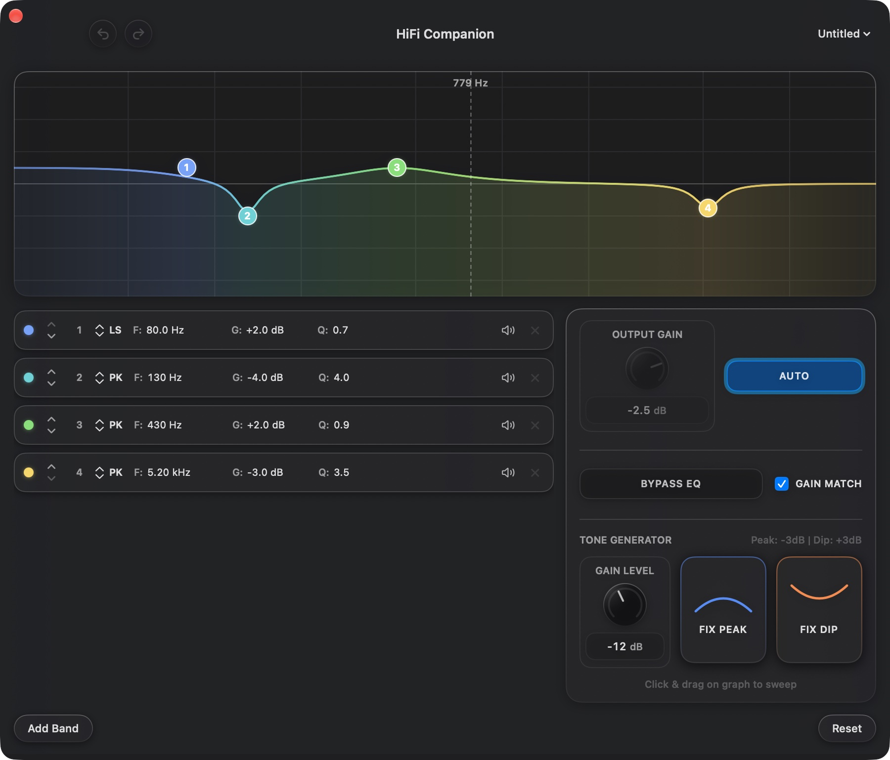

# HiFi Companion

A macOS menu-bar companion for listening on a hardware DAC.

- **System-wide PEQ** — up to 10 parametric bands (peaking, low shelf, high shelf) on whatever other apps play to your DAC, through a Core Audio process tap.
- **Apple Music SB matching** — switches the DAC's sample rate and bit depth (SB) to the current Music track, only while Music is the only app using the DAC.
- **Sine sweep** — press and drag on the EQ graph to hear a tone, find peaks and dips by ear, and fix them with one click.

It is not a music player.



## Status

Release **0.2.0 (19)** (tag `v0.2`). Development continues on `main`. History and rollback: [docs/releases.md](docs/releases.md).

## Requirements

- macOS 14.2 or later (process taps). Developed on macOS 27.
- A hardware DAC or other hardware output.
- To build: Xcode, and [XcodeGen](https://github.com/yonaskolb/XcodeGen) when `project.yml` changes.
- The app is not sandboxed (Music format detection reads `log stream`), so it is not an App Store app.
- The first time Pass-through is enabled, macOS asks for **System Audio Recording**. It is not the microphone, and nothing is recorded to disk.

## Build and install

```bash
xcodebuild -scheme "HiFi Companion" -configuration Release -derivedDataPath build
ditto "build/Build/Products/Release/HiFiCompanion.app" ~/Applications/HiFiCompanion.app
open ~/Applications/HiFiCompanion.app
```

Install to the same path every time so the permission stays attached to the app. Full steps, tests, and versioning: [AGENTS.md](AGENTS.md#build-test-install).

## Repository layout

```
HiFiCompanion/              App sources
  Audio/                    Devices, process tap, PEQ, sweep, profiles
  Detection/                Apple Music format detection
HiFiCompanionTests/         Unit tests (hosted in the app)
docs/                       Product, architecture, audio, EQ window, releases
  media/                    Screenshots and reference mockups
project.yml                 XcodeGen spec (source of truth for the Xcode project)
AGENTS.md                   Onboarding for AI agents and contributors
CLAUDE.md                   Claude Code entry (imports AGENTS.md)
.cursor/rules/              Cursor rule for the locked EQ footer
```

## Documentation

Start with [AGENTS.md](AGENTS.md). Topic docs:

- [Product](docs/product.md) — scope, features, roadmap, known gaps
- [Architecture](docs/architecture.md) — process model, source map, automation, tests
- [Audio path](docs/audio-path.md) — SB matching, process tap, PEQ, sweep
- [EQ window](docs/eq-window.md) — UI spec and visual target
- [Pitfalls](docs/pitfalls.md) — regressions and the fixes to keep
- [Working agreement](docs/working-agreement.md) — how the project is run
- [Releases](docs/releases.md) — versions, rollback, version bumps
