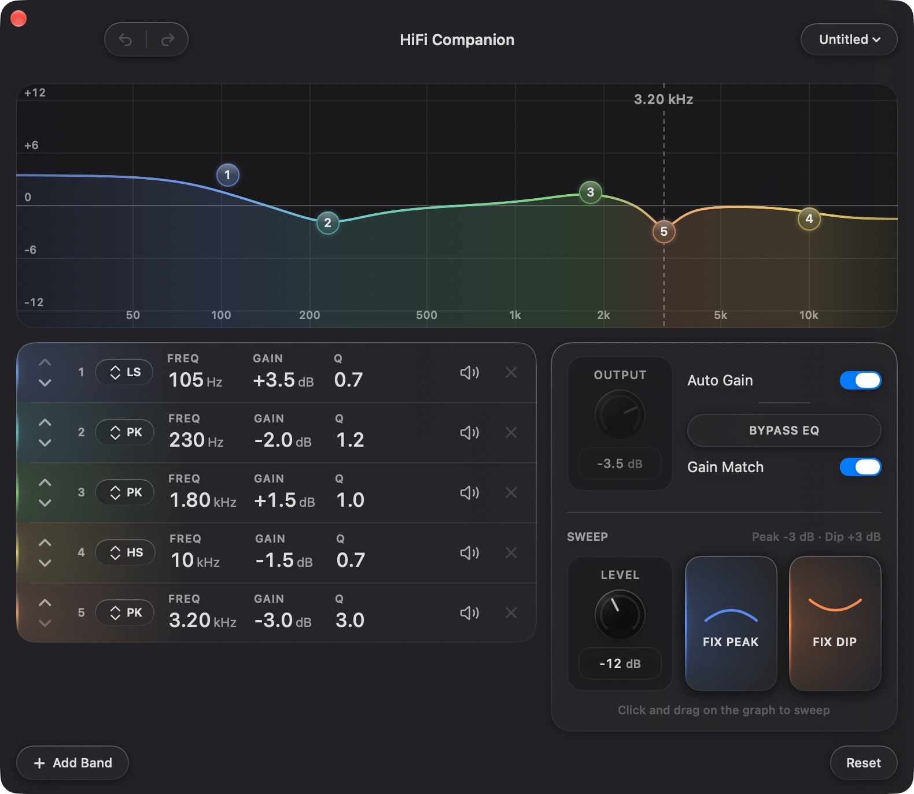
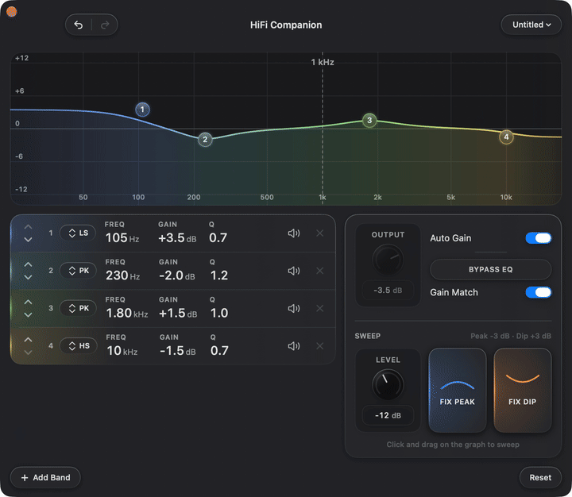

# HiFi Companion

[](https://github.com/SirReal7808/hifi-companion/actions/workflows/tests.yml)
[](LICENSE)


A macOS menu-bar companion for listening on a hardware DAC.

- **System-wide PEQ**: up to 10 parametric bands (peaking, low shelf, high shelf) on whatever other apps play to your DAC, through a Core Audio process tap. No virtual audio device, no loopback hop.
- **Apple Music sample rate / bit depth matching**: switches the DAC to the current Music track's sample rate and bit depth (e.g. 44.1 kHz / 16-bit → 96 kHz / 24-bit) at each track change, only while Music is the only app using the DAC.
- **Sine sweep**: press and drag on the EQ graph to hear a tone, find peaks and dips by ear, and fix them with one click.

It is not a music player.

<picture>
  <source media="(prefers-color-scheme: light)" srcset="docs/media/eq-v0.5-light.jpg">
  
</picture>

**Sweep → FIX PEAK:** drag on the graph to hear a sine at the needle; where it jumps out, release and press FIX PEAK to cut it with a −3 dB band.



## Download

Signed and notarized builds are on the [Releases page](https://github.com/SirReal7808/hifi-companion/releases/latest) as a `.dmg`. Drag the app to **Applications** and open it; it lives in the menu bar and updates itself (Sparkle).

The first time the Parametric Equalizer is turned on, macOS asks for **System Audio Recording**. It is not the microphone, and nothing is recorded to disk.

Requires macOS 14.2 or later (process taps) and a hardware DAC or other hardware output. The app is not sandboxed (Music format detection reads `log stream`), so it is not an App Store app.

## How it works

- **Process tap, not a virtual device.** A `CATapDescription` captures what other processes send to the output device and mutes their direct output while tapped. A private aggregate device (the DAC plus the tap) runs one IOProc that applies the EQ and plays the result on the same DAC. Apps keep targeting your DAC, so nothing is rerouted. [Audio path](docs/audio-path.md#pass-through-process-tap--dac).
- **Allocation-free realtime path.** The IOProc runs 10 RBJ-cookbook biquads in place on Float32 buffers with preallocated scratch space, so the callback does no heap allocation. [Pitfalls](docs/pitfalls.md) records what broke before this was the rule.
- **Bit-exact when flat.** `scripts/null-test.sh` plays a known signal through the flat path and compares what the IOProc hands the DAC with the source file sample by sample. On USB outputs the result is identical (measured at 44.1 kHz on a Topping DX5 II). That only holds with drift compensation off on hardware-clocked outputs, which the app does. [Null test](docs/audio-path.md#null-test).
- **Detecting Apple Music's sample rate and bit depth.** Music does not announce its track format, so the app tails the Core Audio log for the stream format, cross-checks the playing track with AppleScript, and switches the DAC only at track changes. A gate ignores mid-track format noise (next-track preload, adaptive streaming variants), and an exclusive lock waits until Music is the only audible client on the DAC. [Format matching](docs/audio-path.md#sb-matching-apple-music-mode).

## Known behavior

- **Apple Music Mode waits for browsers.** Sample rate / bit depth matching pauses while another app plays to the output. Browsers (Chrome, Safari) keep their audio stream open for about 10 seconds after you pause a video, so matching resumes about 10 seconds later. This is expected.
- **A rate change costs about a second at the start of the track.** When the next track has a different sample rate, the DAC relocks to it as the track starts; most DACs go quiet (some click) for about a second. This is normal for any player that switches rates.
- **The first moment of a sweep can be silent.** With nothing playing, the DAC needs a moment to wake (about 1 second on the Topping DX5 II, its anti-pop delay). With music playing, the sweep is instant.

## Build from source

Needs Xcode and [XcodeGen](https://github.com/yonaskolb/XcodeGen) (`brew install xcodegen`).

```bash
xcodegen generate   # after any project.yml change
xcodebuild -scheme "HiFi Companion" -configuration Release -derivedDataPath build.noindex
ditto "build.noindex/Build/Products/Release/HiFiCompanion.app" ~/Applications/HiFiCompanion.app
open ~/Applications/HiFiCompanion.app
```

Install to the same path every time so the permission stays attached to the app. A local build is signed ad-hoc unless you have the project's Developer ID certificate, so macOS asks for System Audio Recording again after each rebuild. Tests, versioning and automation flags: [AGENTS.md](AGENTS.md#build-test-install).

## Built with AI agents

This project is developed with Claude Code and the repo is set up for it: [AGENTS.md](AGENTS.md) is the single onboarding entry, `.claude/` holds the task loop as skills (`/task`, `/handoff`, `/install`, `/release`), two read-only reviewer agents for the EQ window and the realtime audio path, and a hook that blocks hand edits to the generated Xcode project and pushes to `main`. [Working agreement](docs/working-agreement.md) describes the workflow.

## Repository layout

```
HiFiCompanion/              App sources
  Audio/                    Devices, process tap, PEQ, sweep, profiles
  Detection/                Apple Music format detection
HiFiCompanionTests/         Unit tests (hosted in the app)
docs/                       Product, architecture, audio, EQ window, releases
  media/                    Screenshots and reference mockups
project.yml                 XcodeGen spec (source of truth for the Xcode project)
AGENTS.md                   Onboarding for AI agents and contributors
CLAUDE.md                   Claude Code entry (imports AGENTS.md)
.claude/                    Claude Code skills, reviewers, hooks
scripts/                    null-test.sh, package-release.sh, Sparkle signing helper
.cursor/rules/              Cursor rule for the locked EQ footer
```

## Documentation

Start with [AGENTS.md](AGENTS.md). Topic docs:

- [Status](docs/status.md): what is in flight, next tasks, backlog
- [Product](docs/product.md): scope, features, roadmap, known gaps
- [Architecture](docs/architecture.md): process model, source map, automation, tests
- [Audio path](docs/audio-path.md): sample rate / bit depth matching, process tap, PEQ, sweep
- [EQ window](docs/eq-window.md): UI spec and visual target
- [Pitfalls](docs/pitfalls.md): regressions and the fixes to keep
- [Working agreement](docs/working-agreement.md): how the project is run
- [Releases](docs/releases.md): versions, rollback, version bumps

## License

[MIT](LICENSE) © 2026 Mert Lafcı
