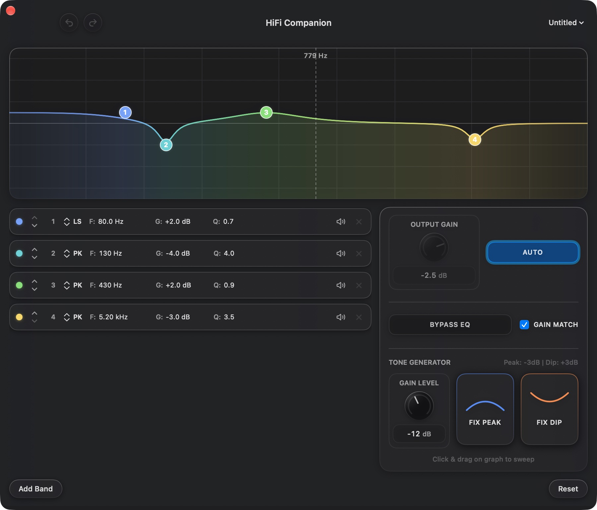
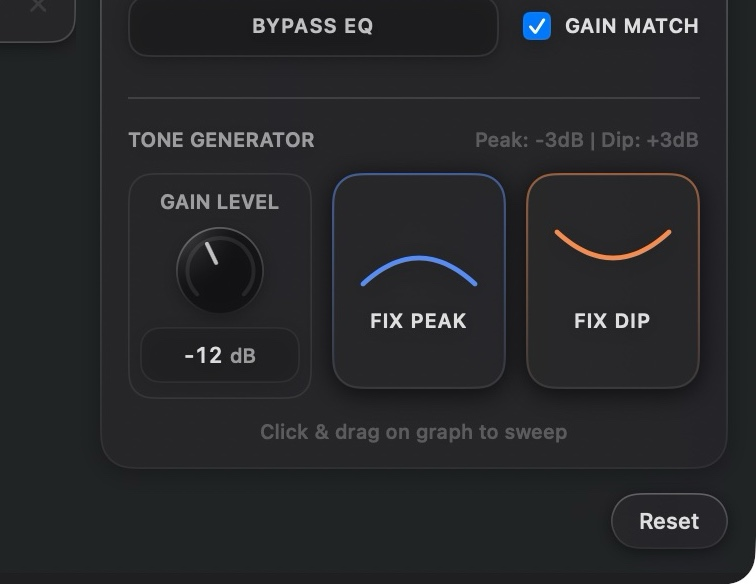
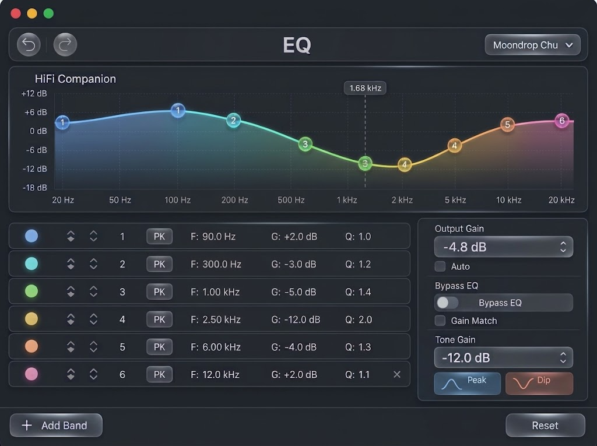
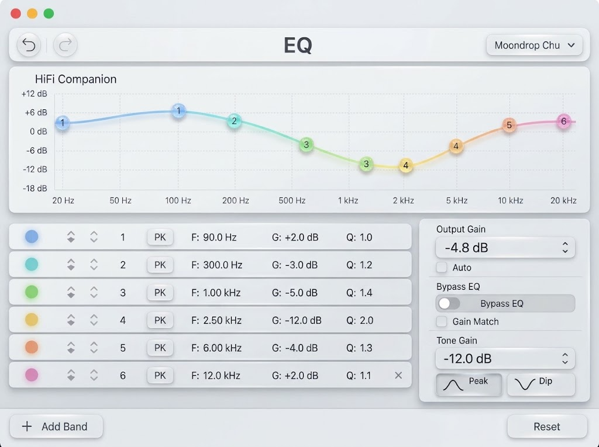

# EQ window

The floating EQ window: layout, interaction, visual target, window chrome, and the **locked compact footer**. Shipped in v0.2 and approved by Mert. Do not reopen any decision here unless Mert asks.

## Layout

One window, **no tabs**. Top to bottom:

1. **Toolbar** — leading inset for the close button, circular Undo / Redo (⌘Z / ⇧⌘Z, also ⌘Y), centered title "HiFi Companion", trailing glass **profile menu** (shows the active profile name, `*` when dirty, "Untitled" when none).
2. **Response graph** — always visible, full width. Press-drag is always the sweep.
3. **Middle** — band list on the left, **side glass** on the right (~36 % of the width, at least 268 pt).
4. **Footer chips** — **Add Band** (left) and **Reset** (right) on the window background.

The menu bar keeps Pass-through, SB, lock, PEQ…, test tone, device pin, and Appearance. No status or helper lines in the EQ chrome (bit-perfect, peak boost, needle hints); the clipping warning is a **graph overlay**, never an in-flow banner (banners grew the height and pushed FIX PEAK / FIX DIP under the footer).

## Bands

- Show **used bands only**; Add Band adds one (max **10**).
- Row: color dot, ↑↓ reorder, index, filter type menu (PK / LS / HS), `F:` / `G:` / `Q:` text (double-click to type), per-band enable (speaker), remove (×).
- **No knobs on band F / G / Q.** Knobs exist only on Output Gain and Gain Level in the side glass.
- Drag graph handles for F and G; Q is typed. Reorder with **↑ / ↓ only** (no list drag). Indices match graph handles 1…N.
- Filter types: peaking (PK, default), low shelf (LS), high shelf (HS). Switching peaking → shelf sets Q to 0.7.
- Limits: 20 Hz–20 kHz, ±14 dB, Q 0–10.

## Sweep (always on the graph)

- Press-drag plays the tone; release mutes; the needle parks with a small frequency label. Only one needle.
- **FIX PEAK** = you heard a peak → add a **cut** (−3 dB). **FIX DIP** = you heard a dip → add a **boost** (+3 dB). Q **3**. The side panel shows `Peak: -3dB | Dip: +3dB`.
- **GAIN LEVEL** (tone level): default **−12 dB**, range **−20…0 dB**.
- Audio behavior (wake engine, mixing before PEQ): [audio-path.md](audio-path.md#sweep).

## Side glass

One soft glass group with three sections split by thin hairlines:

| Section | Contents |
|---|---|
| **OUTPUT GAIN** | Framed stack (label · knob · dB field) + **AUTO** toggle button sharing the row. Knob / field disabled while Auto is on. |
| **BYPASS EQ** | Prominent toggle + **GAIN MATCH** checkbox |
| **TONE GENERATOR** | Framed **GAIN LEVEL** stack (same chrome as OUTPUT GAIN) + large side-by-side **FIX PEAK** / **FIX DIP** cushion buttons with peak / dip curve icons; caption "Click & drag on graph to sweep" |

Details that are decided:

- ALL CAPS section labels; FIX PEAK / FIX DIP wording; no steppers.
- Hairline above TONE GENERATOR (between Bypass and Tone), same style as between Output and Bypass.
- Knobs: quiet radial, −135°…+135°, vertical drag. Scroll 0.1 dB per tick (max 0.25 dB per event). **Trackpad inverted** (two-finger drag down decreases dB); mouse wheel unchanged.
- SF Pro via `.font(.system(…))` — never `.rounded`. No emoji.
- Checkboxes are a pure-SwiftUI `GlassCheckbox`, not AppKit `.toggleStyle(.checkbox)`.
- FIX PEAK / FIX DIP are the primary feature of the app; keep them large.

v0.1 was the last build **without** this side UX. Do not silently revert to text-only Output / Tone controls unless Mert asks for v0.1.

## Profiles

Save / load named profiles from the toolbar menu. Save prefills the active name; an existing name asks **"Already exists. Overwrite?"**. Delete confirms. Loading a profile marks it active (clean); edits mark it dirty (`*`). Reset clears the active profile.

## Reset

Reset confirms with an `.alert` ("Remove all bands and restore Output Gain to 0 dB."). Use `.alert`, not `.confirmationDialog` (its buttons did not receive clicks in this window). Middle hit-testing is disabled while an alert is up.

## Window height

- Width locked at **900 pt**. Height is exactly **H(N)** with `min == max`; the window is not resizable.
- The middle hugs `max(band list, measured side glass)`; the band list is never shorter than the 4-band layout. The list scrolls when it is taller than the middle.
- On short screens: shrink the graph first (228 → min 140 pt), then the middle; clamp to `visibleFrame − 16`. Never clip the side glass to make it fit.
- Height changes only when the band count, the measured side height, or the screen cap changes. The window keeps its top-left corner when it resizes.
- Sizing logic: `PEQPanelMetrics` and `ExactHeightEQPanel` in `PEQPanelController.swift`.

## Compact footer — locked (2026-10-27)

Approved at `eq-footer-compact-v4` / 0.2.0 (19). **Do not regress** unless Mert explicitly changes it. If a layout or height change would violate it, stop.

1. **No** separate dark footer bar, strip, or fixed-height footer container.
2. **Add Band** and **Reset** sit on the **main window background**.
3. The pad **above** those chips **equals** the pad **below** (`PEQPanelMetrics.footerChipInset` = 12 on both sides; `footerClearance == 0`).
4. The side glass keeps its bottom **rounded corners and drop shadow fully visible**.
5. Window height hugs `max(band list, side glass) + compact chrome`; no void under the bands beyond the taller column (`sideShadowBleed == 0`).

Never (unless Mert asks):

- `.clipped()` / `.compositingGroup()` on the middle column (cuts the glass corners and shadow).
- A `GeometryReader` or fixed-height shell around the side glass that masks overflow.
- A footer layer that covers the bottom of the side glass.
- `layoutPriority` on the middle that expands it and opens a gap above the chips.
- Growing H(N) with fake bleed under a short side panel.

`testCompactFooterInvariant` in `PEQPanelMetricsTests` must stay green. Cursor users also get [`.cursor/rules/eq-compact-footer.mdc`](../.cursor/rules/eq-compact-footer.mdc).

## Window chrome

- A normal `NSWindow` at **normal** level (not an always-on-top `NSPanel`); other apps can cover it. Opening from the menu activates it once.
- Style: titled + closable + miniaturizable + `fullSizeContentView`; transparent titlebar, hidden title. **Not resizable.**
- Miniaturize and zoom buttons are alpha-hidden and disabled (they keep their layout slots so close sits in the standard position). `windowShouldZoom` → false; `fullScreenNone`.
- Close button at the standard titled-window inset `(7, 6)`. Never measure insets with a throwaway window (launch crash — see [pitfalls.md](pitfalls.md)).
- The window **and its hosting controller** are recreated on every open (a reused window let the hosting view inflate the height; a reused hosting controller never re-measured the side glass, which clipped Add Band / Reset).

## Visual target

Styling follows Mert's **reference mockups** (approved 2026-10-26). They are generated images and contain mistakes (duplicate handle numbers, a different title); the **intent** below wins.

| Dark | Light |
|---|---|
|  |  |

Materials and feel:

- Soft frosted glass: translucent panels, rounded "cushion" controls, soft outer shadow, light top rim highlight.
- The window sits on a quiet background; content areas are frosted plates, not a flat opaque sheet.
- Band list: one soft glass group with rounded rows, not a plain Settings-style table.
- Follows system light / dark plus the menu-bar Appearance override (System / Light / Dark). Native materials so it matches the current macOS.

Graph:

- Log 20 Hz–20 kHz with a dB grid. Thin continuous curve.
- One numbered colored handle per band — exactly 1…N, no duplicates, matching the list order.
- Soft multi-color wash under the curve following band colors (blue → teal → green → yellow → orange → pink). Visible but soft — not neon, not a heavy fill.
- One parked sweep needle with a small frequency label.

When implementing or regenerating visuals:

- F / G / Q values must agree between the graph and the rows.
- No extra floating badges, duplicate needles, or random glyphs.

**Rejected:** the sparse flat light "Liquid Glass" concept. Do not revive it as the visual direction.

## Still deferred

Band reorder motion polish. (Band handle colors and the graph wash are done.)
